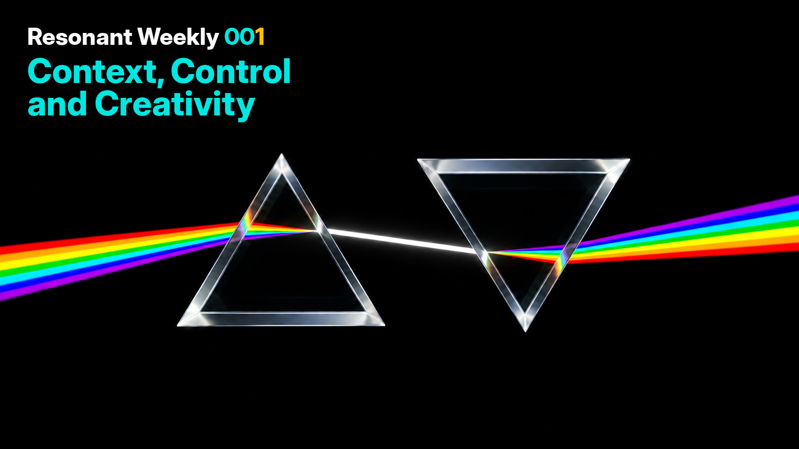

# Resonant Weekly — Issue 001

**12 November 2026 | Community digest | 5–11 November 2026**

Weekly update on what's happening in the Augmentatist community.

This issue focuses on keeping AI context useful, choosing when to run models locally, testing agents against real work, and what makes AI-assisted creativity meaningful.

## In this issue

- [Context Engineering: Keeping the Signal, Losing the Noise](#context-engineering-keeping-the-signal-losing-the-noise)
- [Getting Started: First the Agent, Not the Shopping List](#getting-started-first-the-agent-not-the-shopping-list)
- [Benchmarks That Measure Whether the Work Gets Done](#benchmarks-that-measure-whether-the-work-gets-done)
- [Agent Harnesses: Permissions, Verification and Security](#agent-harnesses-permissions-verification-and-security)
- [Creative AI: Beyond Visual Polish](#creative-ai-beyond-visual-polish)
- [From Children's Drawings to a Playable Game](#from-childrens-drawings-to-a-playable-game)
- [Watch and explore](#watch-and-explore)

---

## Context Engineering: Keeping the Signal, Losing the Noise

**#context-engineering #memory #agents**

What should an AI assistant keep in context—and what should it leave behind? In the **10 November Academy**, participants explored how long sessions accumulate tool outputs, instructions and conversation history, and how compaction can lose details or introduce drift. The discussion moved from stable reference definitions and selective retrieval to separate workspaces, chat branching and disposable sub-agents.

The second half examined the less visible costs of context: loaded tool schemas, prompt noise, KV-cache invalidation and the trade-offs of planner/worker architectures. The broader question was who controls the context layer when work moves between local and cloud models. These are approaches discussed by participants, not guarantees against model errors.

**Watch:** [Context windows & compaction — edited extract](https://youtu.be/j6ZOyVn_oEM) · [Advanced agents, KV caching & sovereignty — edited extract](https://youtu.be/ijolFo0ANQU) · [Full Academy session](https://youtu.be/OoFot8SX1S8)

## Getting Started: First the Agent, Not the Shopping List

**#local-ai #hardware #sovereignty**

A recurring question in the hardware discussions was whether it is worth buying GPUs and extra RAM now, or waiting. Members compared VRAM limits, memory bandwidth, Linux distributions, single versus multiple GPUs, and the practical costs of local inference. There was no single agreed hardware answer: recommendations depended on workload, budget and willingness to maintain a local stack.

One particularly useful suggestion was to **set up an agent harness first**, use hosted models where needed, and learn which tasks and model sizes actually justify purchasing hardware. The same discussion highlighted the importance of permissions and isolation: running locally does not automatically make an agent safe.

**Explore:** [Start with the agent before investing in hardware](https://discord.com/channels/1423225702135894111/1517639386215350424/1570075011992133745) · [VRAM, bandwidth and GPU trade-offs](https://discord.com/channels/1423225702135894111/1517639386215350424/1568348066598228050)

## Benchmarks That Measure Whether the Work Gets Done

**#evaluations #models #coding**

Speed and tokens per second are only part of a useful model comparison. In **#ai-models**, a member described testing local models on a DGX Spark against repeatable software-development tasks from real, complex repositories. The proposed evaluation combined throughput and time-to-first-token with task completion, adherence to tests and whether the agent wandered off course.

A useful disagreement emerged over reproducibility: some details could not be published because they came from client work, while others argued that readers still need a clear description of each task's objective. Results were **offered for sharing**, not established as a definitive community benchmark.

**Explore:** [Benchmark proposal](https://discord.com/channels/1423225702135894111/1491424406595964958/1569462697857130661) · [Detailed testing method and limitations](https://discord.com/channels/1423225702135894111/1491424406595964958/1569488908922781747)

## Agent Harnesses: Permissions, Verification and Security

**#harnesscraft #security #agents**

In **#harnesscraft**, one discussion asked whether an agent could work through S3 or Azure Blob Storage instead of unrestricted local filesystem access. Suggestions included a storage adapter, a constrained tool registry, explicit state management and independent verification. The unresolved challenge: coding agents still need ways to compile, test and run tools without simply bypassing those boundaries.

Later, a member shared a coding-delegation plugin intended to reduce prompt-injection risks and add approval and signing controls. The accompanying security review prompted questions about remaining findings and how the protection works. **A published review is evidence of scrutiny, not proof of security.**

**Explore:** [Object-storage agent design](https://discord.com/channels/1423225702135894111/1546522589852340280/1568864631303307285) · [Security plugin and review discussion](https://discord.com/channels/1423225702135894111/1546522589852340280/1570112462580220024)

## Creative AI: Beyond Visual Polish

**#creative-ai #video #storytelling**

Can AI-generated video look cinematic—and would that make it good cinema? A discussion in **#video-generation** separated technical image quality from story, continuity and the attention an audience is willing to give. Some members were optimistic about the medium; others argued that even visually striking examples still struggle to sustain a compelling story.

Practical experiments ran alongside the debate, including combining Midjourney images with subsequent AI edits, and dealing with continuity errors such as extra hands. The recurring challenge was not merely generating convincing frames but directing, revising and judging the finished work.

**Explore:** [Creative quality and audience trust](https://discord.com/channels/1423225702135894111/1544435111934566460/1569838014635708520) · [Mixed-tool image and video workflow](https://discord.com/channels/1423225702135894111/1544435111934566460/1568295562451615816)

## From Children's Drawings to a Playable Game

**#education #creative-coding #iteration**

In **#youth-education-tech**, a member shared a game built with a six-year-old using the child's monster drawings and AI-assisted coding. The first version was disappointing despite extensive preparation. The subsequent redesign was more instructive: fewer reading demands, immediate feedback for button presses, spoken instructions and clearer game mechanics.

This is a reported family experiment, not a formal evaluation, but it offers a tangible lesson in **designing for the actual user** and testing an AI-generated prototype before treating it as finished.

**Explore:** [The game and original artwork](https://discord.com/channels/1423225702135894111/1543996880441180240/1569799767930704032) · [What changed after the first version](https://discord.com/channels/1423225702135894111/1543996880441180240/1569800257707970671)

---

## Watch and explore

### Academy — 10 November 2026

- **[Context Window Management & Compaction](https://youtu.be/j6ZOyVn_oEM)** — edited first segment. Useful starting points: [compaction, 00:00](https://youtu.be/j6ZOyVn_oEM?t=0), [memory retrieval noise, 14:08](https://youtu.be/j6ZOyVn_oEM?t=848), [branching chats, 21:21](https://youtu.be/j6ZOyVn_oEM?t=1281).
- **[Advanced Agent Architectures & KV Caching](https://youtu.be/ijolFo0ANQU)** — edited second segment. Useful starting points: [KV caching, 01:30](https://youtu.be/ijolFo0ANQU?t=90), [multi-agent delegation, 05:08](https://youtu.be/ijolFo0ANQU?t=308), [sovereignty and monoculture, 13:50](https://youtu.be/ijolFo0ANQU?t=830).
- **[Full Academy recording](https://youtu.be/OoFot8SX1S8)** — including [context drift, 12:00](https://youtu.be/OoFot8SX1S8?t=720), [planner/worker architectures, 48:00](https://youtu.be/OoFot8SX1S8?t=2880), and [data sovereignty, 1:13:50](https://youtu.be/OoFot8SX1S8?t=4430).

**AI Stack — 11 November:** No recording is included this week. The meeting chat shared links and questions about coding harnesses, local inference, model deployments and agent governance. Without a recording, those messages are treated as pointers for exploration rather than a summary of what speakers said during the call.

---

*Resonant Weekly is a selective digest of community discussions, not a transcript or a claim of independent verification. Technical recommendations and performance reports reflect the experiences and opinions shared at the time. Links to Discord require access to the Resonant server.*
